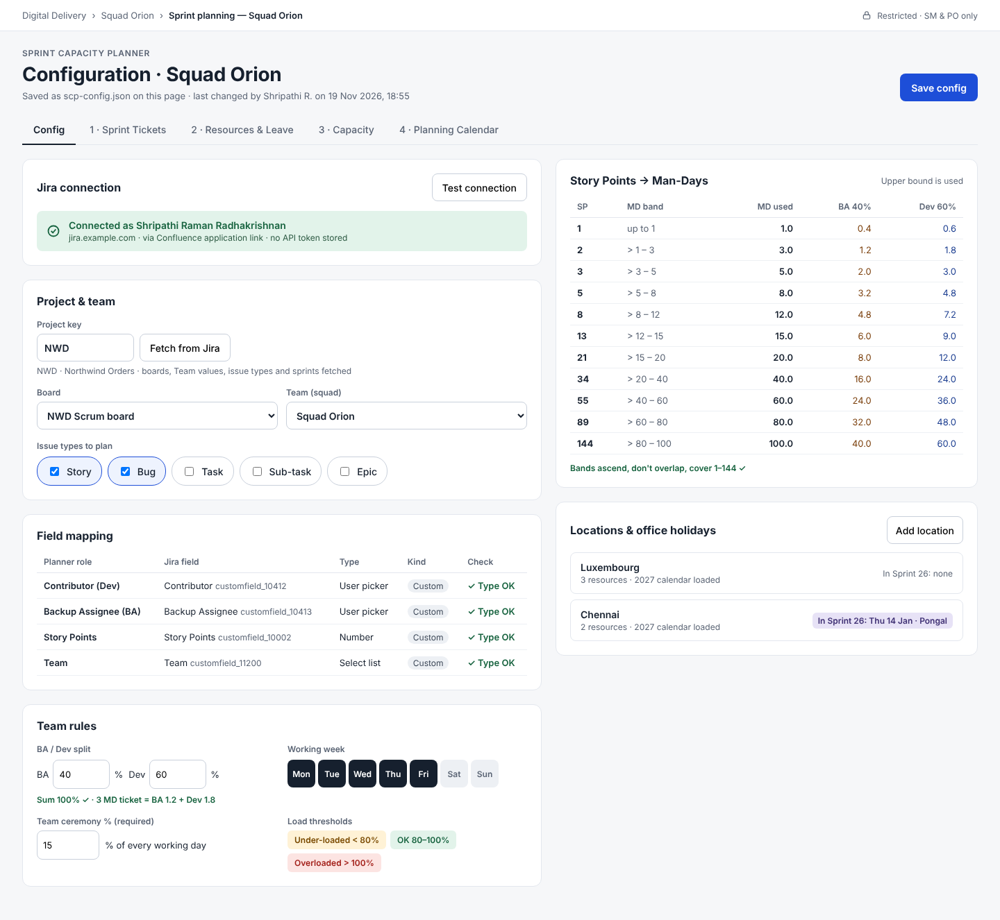
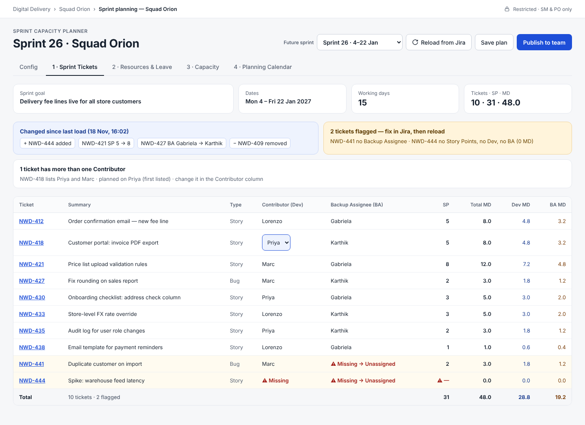
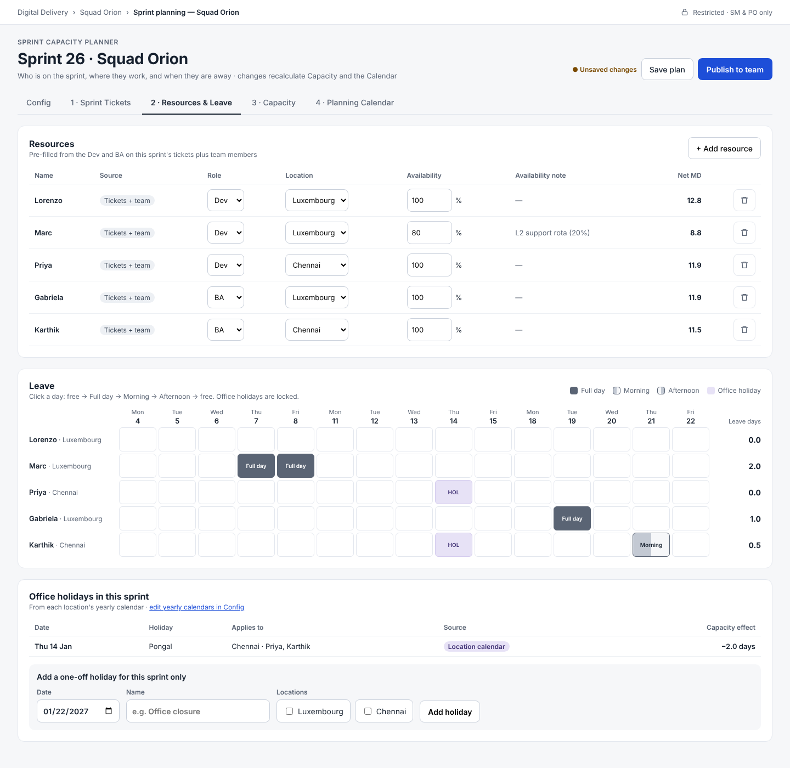
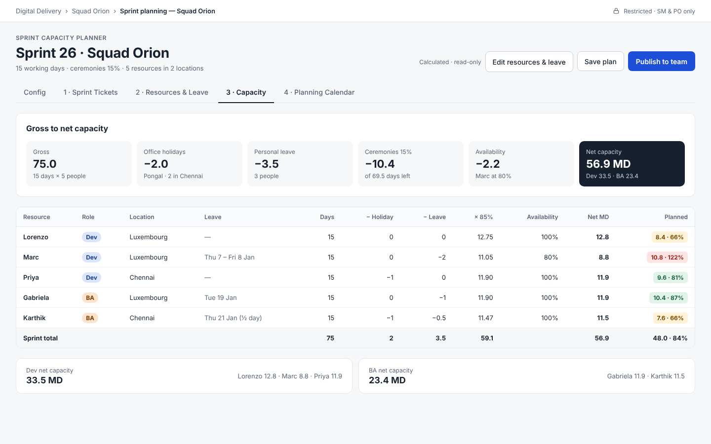
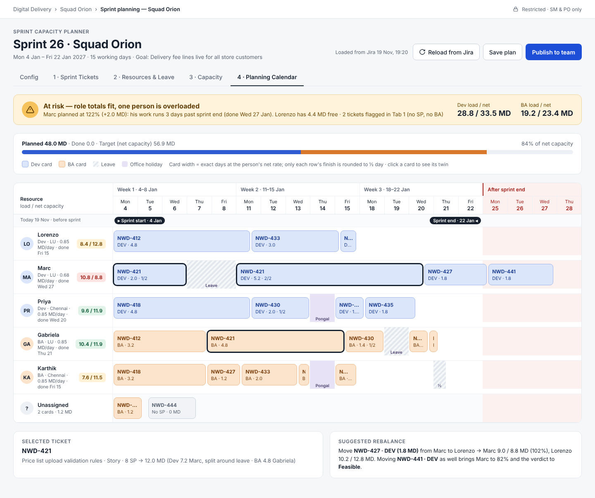
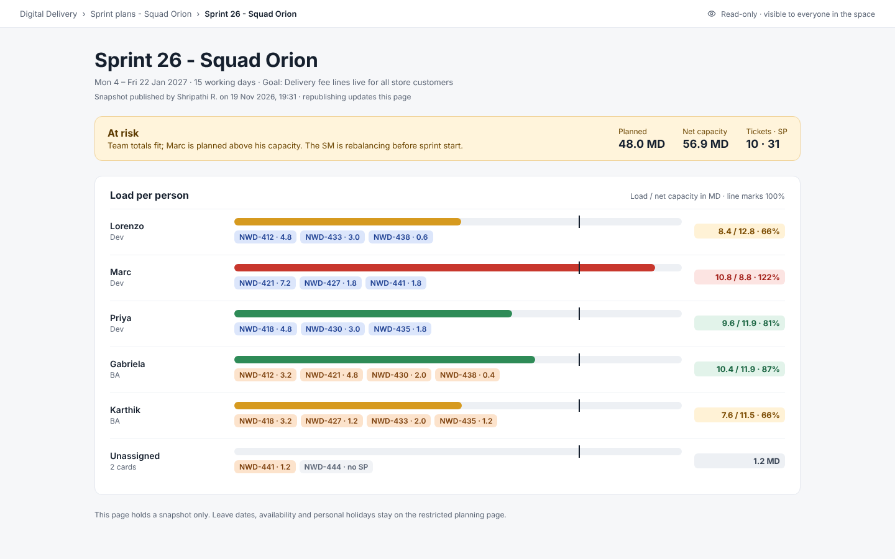

# PRD: Sprint Capacity Planner (Confluence + Jira)

Nov 19, 2026 · @Shripathi Raman R · Status: Draft v0.5

## Overview

### Problem Statement

Scrum Masters commit sprints without knowing whether the people named on the tickets have the days to deliver them. Story points sit in Jira, holidays and leave sit in people's heads or spreadsheets, and the BA and Dev share of each ticket is never made explicit. The result is over-committed individuals, unfinished sprints and late scope cuts.

### Solution Summary

A Sprint Capacity Planner embedded in a Confluence page, fed live from Jira. It has five tabs:

1. **Config**: connect to Jira, test the connection, pick project, team/squad and issue types, map fields, define the Story Point to Man-Day (MD) bands and the BA/Dev split.
2. **Sprint Tickets**: the selected future sprint's tickets with Dev, BA, Story Points and the derived Total, Dev and BA MD.
3. **Resources & Leave**: the people on the sprint with role, location and availability %, a day-by-person leave grid, and the office holidays that fall in this sprint.
4. **Capacity**: read-only calculation of gross capacity from sprint dates and resources, minus office holidays, personal leave, ceremonies and availability, giving net capacity per person and per role.
5. **Planning Calendar**: a day-by-resource calendar where the SM places and drags work, sees each person's load against capacity, and gets a feasible / at-risk / not-feasible verdict for the sprint.

The reference for look and behaviour is Bloompeak's [Sprint Capacity Planner for Jira](https://bloompeak.atlassian.net/wiki/spaces/DOC/pages/2651619334/Sprint+Capacity+Planner+for+jira). The difference: this one lives on Confluence and models the BA/Dev split of every ticket. It is built like the Release Impact Dashboard: an HTML macro on a planning page restricted to the SM and PO, reading Jira through the Confluence-Jira application link, and a read-only page per sprint that everyone can view.

### Target Users

| User | What they do in the tool |
| --- | --- |
| Scrum Master (primary) | Configures, enters holidays and capacity, assigns work, decides on sprint commitment |
| Product Owner | Reads the verdict and trims scope when the sprint is not feasible |
| Team members (Dev, BA) | Read the published team view: load per person and verdict, no leave detail |
| Delivery / Change Manager | Reads plans across sprints to spot chronic overload |

## Goals & Success Metrics

### Goals

1. Every sprint commitment is backed by a capacity check, per person and per role, before sprint start.
2. No individual is planned above 100% of their net capacity without an explicit SM decision.
3. Sprint planning preparation takes less time than the current spreadsheet-and-Jira routine.

### Success Metrics

Baselines do not exist yet. They are measured manually over the two sprints before pilot (see Timeline).

| Metric | Current Baseline | Target | Timeline |
| --- | --- | --- | --- |
| Sprint completion: committed MD done / committed MD | To measure (2 sprints) | +15 points vs baseline | After 3 pilot sprints |
| Resources planned above 100% at sprint start | To measure | 0 without an override note | From pilot sprint 1 |
| SM preparation time per sprint planning | To measure (self-reported) | -50% vs baseline | After 3 pilot sprints |
| Tickets entering the sprint with missing SP, Dev or BA | To measure | 0 | From pilot sprint 2 |
| Plans created in the tool / sprints run | 0% | 100% for pilot team | Pilot end |

### Non-Goals

- Not a time-tracking or timesheet tool: actuals are not recorded.
- Not a replacement for Jira's sprint board or backlog grooming.
- Not a cross-team portfolio planner in v1: one team, one sprint per plan.
- Not an estimation tool: Story Points stay owned by the team in Jira.

## User Stories

| ID | User Story | Priority |
| --- | --- | --- |
| US-1 | As an SM, I want to connect the page to Jira and test the connection, so that I know data will load before planning starts | P0 |
| US-2 | As an SM, I want project, team/squad and sprints fetched automatically, so that I don't type them by hand | P0 |
| US-3 | As an SM, I want to choose which issue types are planned, so that sub-tasks or epics don't inflate the load | P0 |
| US-4 | As an SM, I want to define Story Point to MD bands and the BA/Dev split once, so that every ticket converts the same way | P0 |
| US-5 | As an SM, I want to see each ticket's Dev, BA, SP, Total MD, Dev MD and BA MD for the sprint, so that I know the workload per role | P0 |
| US-6 | As an SM, I want to reload from Jira and see what changed, so that late grooming changes are not missed | P0 |
| US-7 | As an SM, I want gross and net capacity calculated from sprint dates, office holidays, leave and availability, so that the commitment reflects real days | P0 |
| US-8 | As an SM, I want a calendar where I drag work between people and days, so that I can rebalance load before sprint start | P0 |
| US-9 | As an SM, I want a clear verdict on whether the sprint can be finished, so that I can decide to commit or trim scope | P0 |
| US-10 | As an SM, I want to publish a read-only view of the plan for the team, so that everyone sees the commitment without seeing each other's leave | P1 |
| US-11 | As a PO, I want to see which tickets cause the overload, so that I know what to drop | P1 |
| US-12 | As a team member, I want to see my own load and leave on the page, so that I can correct it before commitment | P2 |

Acceptance criteria sit in the Functional Requirements below (FR-n).

## Scope

### In Scope

- Jira read through the Confluence-Jira application link (no API token), connection test, auto-fetch of boards, Team values, issue types, fields and sprints with state
- Configurable SP to MD bands (upper bound used) and BA/Dev split percentage (default 40 / 60)
- One open plan per page; one page per team
- Ticket table with derived MD per role, reload and change detection
- A Resources & Leave tab for people, leave and this sprint's holidays; read-only gross and net capacity with location-based office holidays, personal leave, team ceremony % and personal availability %
- Calendar planning with drag-and-drop, live load per resource, sprint verdict
- Planning page restricted to SM and PO; plan saved as a page attachment; read-only once the sprint starts
- Publish creates one read-only page per sprint, titled "\<Sprint name> - \<Squad name>", viewable by everyone, without leave detail

### Out of Scope

- Any write-back to Jira (assignees, dates, story points): the plan stays in Confluence
- Tracking actual effort or burndown during the sprint
- Planning several sprints or several teams on one page
- Integration with HR leave systems (leave is entered by the SM)
- Roles other than Dev and BA (QA, Ops) in v1

### Future Considerations

- Push Dev/BA reassignments to Jira - plan stays in Confluence for the pilot; revisit once SMs trust the plan
- Import of leave from an HR or Outlook calendar - removes double entry, needs a separate integration and data-privacy review
- More roles with their own split (e.g. QA 20%) - v1 proves the two-role model first
- Multi-sprint and cross-team view for Delivery Managers - needs the single-sprint model to be stable
- Velocity-based sanity check (planned SP vs last 3 sprints) - cheap add once plans are stored

## Solution Design

### Functional Requirements

#### Config tab

Screen design: [Config](https://claude.ai/artifact/DMiZHX8VHaXQPBSEfd7bpY#artboard-Config)



- FR-1: Jira (jira.group.bank) is reached through the Confluence-Jira application link, as in the Release Impact Dashboard; no API token is stored. **Test connection** calls Jira through the link and shows the connected user's name, or the failure reason: link not configured, user not yet authorised on the link, or no permission on the project.
- FR-2: After a project is selected, the tool fetches boards, Team values, issue types and sprints automatically. Sprints show name, state (active, future, closed), start and end date.
- FR-3: The SM multi-selects the issue types to plan (e.g. Story, Bug). Only those types load in Tab 1.
- FR-4: The SM maps Jira fields: Contributor (Dev), Backup Assignee (BA), Story Points and Team. Contributor and Backup Assignee may be single or multi-user pickers (see FR-32). Pickers list the instance's fields with their type and show whether each is a Jira standard or custom field; the tool works with either. A field of the wrong type (e.g. text instead of user picker or number) is rejected.
- FR-5: The SM maintains SP to MD bands: SP value, MD lower bound (exclusive), MD upper bound (inclusive). The tool always uses the upper bound: 5 SP banded above 5 up to 8 MD counts as 8 MD. Bands must ascend, not overlap, and cover every SP value the team uses; the SM configures them up to 144 SP (Fibonacci scale 1, 2, 3, 5, 8, 13, 21, 34, 55, 89, 144).
- FR-6: The SM sets BA % and Dev %, default 40 / 60. Save is blocked unless they sum to 100.
- FR-7: The SM sets the working week (default Mon-Fri), the team ceremony % (share of every working day spent in stand-up, refinement, review and retro; required, no default) and load thresholds (default: under-loaded below 80%, overloaded above 100%).
- FR-27: The SM maintains locations (e.g. Luxembourg, Chennai), each with its own office holiday calendar for the year.
- FR-8: Config is saved as a JSON attachment on the planning page, with last-changed by and date shown.

#### Tab 1 - Sprint Tickets

Screen design: [Tab 1 · Sprint Tickets](https://claude.ai/artifact/DMiZHX8VHaXQPBSEfd7bpY#artboard-Tickets)



- FR-9: A sprint selector lists **future** sprints only. **New Sprint Planning** opens a plan for the selected sprint. Each page serves one team and holds one open plan; starting another asks the SM to close the current one first.
- FR-10: The tab header shows sprint name, goal, start date, end date and number of working days.
- FR-11: The ticket table shows Ticket (link to Jira), Summary, Issue type, Contributor (Dev), Backup Assignee (BA), Story Points, Total MD, Dev MD, BA MD, with a totals row.
- FR-12: **Reload from Jira** refetches the sprint and lists what changed since the last load: tickets added or removed, SP changed, Dev or BA changed. The last-loaded time is shown.
- FR-13: Tickets with missing SP, missing Dev, missing BA, or SP outside the bands are flagged and counted. A ticket with no SP, or SP outside the bands, shows 0 MD until fixed in Jira. A ticket missing only its Dev or only its BA keeps its full MD: the named half is planned as usual and the missing half goes to the Unassigned lane (see Edge Cases).
- FR-32: When Contributor or Backup Assignee holds more than one person, Tab 1 shows a dropdown in that cell listing everyone in the field. It defaults to the first name listed, so the ticket is planned straight away; the SM can pick anyone else listed. The ticket keeps its full MD on the chosen person. The choice is saved with the plan and survives Reload; if the chosen person is removed from the field in Jira, the ticket returns to the default and Reload lists the change. An info note counts these tickets; they are not flagged and do not block planning. The dropdown only sets who the ticket starts on: dragging the card to another person in Tab 4 always wins, and the Tab 1 cell then shows that person marked "moved in calendar".

#### Tab 2 - Resources & Leave

Screen design: [Tab 2 · Resources & Leave](https://claude.ai/artifact/DMiZHX8VHaXQPBSEfd7bpY#artboard-Resources)



- FR-15: The resource list is pre-filled from every Dev and BA on the sprint's tickets plus the team's members. The SM can add or remove people and sets each one's role (Dev, BA or Both) and location (from FR-27). A resource with no location blocks the capacity calculation until one is set.
- FR-17: Office holidays come from each resource's location calendar and are deducted only for resources in that location. The SM can add a one-off holiday for this sprint and choose which locations it applies to.
- FR-18: Per resource, the SM sets availability % (default 100) and personal leave dates, in full or half days. Availability % covers the person's own non-sprint time (support duty, part-time, other projects); team ceremonies are deducted separately by the ceremony % (FR-7).
- FR-30: A leave grid shows one row per resource and one column per working day. Clicking a day cycles free → full day → half day → free. Office-holiday days are locked. Each row shows the person's leave total, and each resource shows net MD that updates as leave changes.
- FR-31: The tab lists the office holidays that fall in the sprint, with date, name, locations, source (location calendar or one-off) and capacity effect in days. Yearly location calendars are edited only in Config (FR-27), linked from this list.

#### Tab 3 - Capacity

Screen design: [Tab 3 · Capacity](https://claude.ai/artifact/DMiZHX8VHaXQPBSEfd7bpY#artboard-Capacity)



- FR-14: Working days are derived from sprint start and end date (inclusive) and the working week.
- FR-16: Gross capacity = working days x number of resources, shown in MD.
- FR-19: Net capacity is shown per resource, per role and for the sprint, with the steps from gross to net visible (gross, minus office holidays, minus leave, minus ceremonies, times availability). Tab 3 is read-only: every input is edited in Config or Tab 2, linked from the tab header.

#### Tab 4 - Planning Calendar

Screen design: [Tab 4 · Planning Calendar](https://claude.ai/artifact/DMiZHX8VHaXQPBSEfd7bpY#artboard-Main)



- FR-20: The calendar has one row per resource and one column per working day. Office holidays and leave are shaded; sprint start, end and today are marked. Each row header shows load / net capacity in MD (e.g. 16 / 15), coloured by the FR-7 thresholds.
- FR-21: Each ticket produces a Dev card (Dev MD) on its Contributor's row and a BA card (BA MD) on its Backup Assignee's row. Cards are auto-placed from the first free day; tickets with no person go to an Unassigned lane.
- FR-22: The SM drags a card to another resource or day. Loads and the verdict update immediately. Dropping a Dev card on a BA-only resource asks for confirmation. A dropped card's start snaps to the nearest half day. If it then overlaps another card on that row, the later cards move right to make room. A gap left by snapping stays empty, counts no load and moves the row's Done date. Auto-placed cards (FR-21) stay packed at their exact lengths.
- FR-23: Card length is the number of days the work takes for that person: MD divided by the person's daily rate, (1 - ceremony %) x availability %, drawn at its exact length with no rounding per card. Cards on a row follow one another; only the row's finish point is rounded up to the next half day and shown as a Done date in the row header. A card can be split across non-adjacent days and skips leave and holidays. Load still counts MD, not days. Cards that run past the sprint end show in an After sprint end zone at the right of the calendar.
- FR-24: A verdict banner shows **Feasible**, **At risk** or **Not feasible**, with load vs net capacity per role (see rules below).
- FR-25: **Save plan** stores the plan as a JSON attachment on the planning page. It is the single save for Tabs 1-4 and sits in the same place in every tab's header: one click saves the Tab 1 dropdown choices (FR-32), Tab 2 resources, leave and one-off holidays, and the Tab 4 card placements together. Leaving the page with unsaved changes asks for confirmation. Config keeps its own Save config (FR-8). Nothing is written back to Jira; reassignments made in the calendar live only in the plan.
- FR-26: Once the sprint becomes active in Jira, the plan turns read-only and stays on the page as the commitment record.

#### Access and publishing

Screen design: [Published sprint page](https://claude.ai/artifact/DMiZHX8VHaXQPBSEfd7bpY#artboard-Published); Save plan and Publish sit in every tab's header



- FR-28: The planning page is restricted to the SM and PO through Confluence page restrictions. Only they can edit the plan and see leave dates and availability.
- FR-29: **Publish** creates, on first use, a new Confluence page titled "\<Sprint name> - \<Squad name>" (squad = this page's Team value), readable by everyone. It holds a snapshot: tickets, cards, load and net capacity per resource, verdict. Publishing again updates the same page and never creates a second one. Sprint pages sit under a parent page "Sprint plans - \<Squad name>" in the same space; the first Publish creates that parent if it does not exist. Leave dates, availability % and holidays per person are left out of the snapshot.

### Calculation Rules

**Story Points to MD.** Each SP value maps to a band; the MD used is the band's upper bound.

| Story Points | MD band (default config) | MD used | BA MD (40%) | Dev MD (60%) |
| --- | --- | --- | --- | --- |
| 1 | up to 1 | 1 | 0.4 | 0.6 |
| 2 | above 1, up to 3 | 3 | 1.2 | 1.8 |
| 3 | above 3, up to 5 | 5 | 2.0 | 3.0 |
| 5 | above 5, up to 8 | 8 | 3.2 | 4.8 |
| 8 | above 8, up to 12 | 12 | 4.8 | 7.2 |
| 13 | above 12, up to 15 | 15 | 6.0 | 9.0 |
| 21 | above 15, up to 20 | 20 | 8.0 | 12.0 |
| 34 | above 20, up to 40 | 40 | 16.0 | 24.0 |
| 55 | above 40, up to 60 | 60 | 24.0 | 36.0 |
| 89 | above 60, up to 80 | 80 | 32.0 | 48.0 |
| 144 | above 80, up to 100 | 100 | 40.0 | 60.0 |
| Value with no band | none | configuration gap: flagged, 0 MD until the SM adds a band | - | - |

These are the default bands; the SM can change them in Config (FR-5).

**BA / Dev split.** Dev MD is derived as the remainder so the two always add up to Total MD. Values are rounded to 0.1 MD.

```latex
\begin{aligned}
\text{BA MD} &= \text{Total MD} \times \text{BA\%} \\
\text{Dev MD} &= \text{Total MD} - \text{BA MD}
\end{aligned}
```

At 40 / 60, a 3 MD ticket gives BA 1.2 MD and Dev 1.8 MD (confirmed 19 Nov 2026).

**Capacity.** For resource r, with W working days in the sprint:

```latex
\begin{aligned}
\text{Gross} &= W \times N_{\text{resources}} \\
\text{Net}_r &= (W - \text{OfficeHolidays}_r - \text{Leave}_r) \times (1 - \text{Ceremony\%}) \times \text{Availability}_r \\
\text{Net}_{\text{role}} &= \sum_{r \in \text{role}} \text{Net}_r
\end{aligned}
```

Worked example: a sprint from 3 Aug to 21 Aug has 15 working days. With 5 resources, gross is 75 MD. One Luxembourg holiday leaves 14 days for each Luxembourg resource; Chennai resources keep 15. With an example ceremony % of 15%, a Luxembourg Dev at 80% availability with 2 days' leave nets (15 - 1 - 2) x 0.85 x 0.8 = 8.2 MD. A resource with role Both counts toward each role by the share the SM sets (default 50 / 50).

**Load and verdict.** Load for a resource is the sum of MD of the cards on their row. On the calendar a card is drawn in days, not MD (FR-23): Marc at 80% availability and 15% ceremonies does 0.68 MD a day, so a 7.2 MD card spans 10.6 days. Rounding happens once per row: Lorenzo's 8.4 MD at 0.85 MD a day takes 9.9 days and shows Done at the end of day 10.

| Verdict | Rule |
| --- | --- |
| Feasible | Dev load is at most Dev net, BA load is at most BA net, and no resource is above 100% |
| At risk | Role totals fit, but at least one resource is above 100% or a card sits on a leave/holiday day |
| Not feasible | Dev load is above Dev net, or BA load is above BA net |

### User Experience

All six screens are on the [design canvas](https://claude.ai/artifact/DMiZHX8VHaXQPBSEfd7bpY), built with the sample Sprint 26 (4-22 Jan 2027, Squad Orion) whose numbers follow the Calculation Rules: [Config](https://claude.ai/artifact/DMiZHX8VHaXQPBSEfd7bpY#artboard-Config), [Sprint Tickets](https://claude.ai/artifact/DMiZHX8VHaXQPBSEfd7bpY#artboard-Tickets), [Resources & Leave](https://claude.ai/artifact/DMiZHX8VHaXQPBSEfd7bpY#artboard-Resources), [Capacity](https://claude.ai/artifact/DMiZHX8VHaXQPBSEfd7bpY#artboard-Capacity), [Planning Calendar](https://claude.ai/artifact/DMiZHX8VHaXQPBSEfd7bpY#artboard-Main), [Published sprint page](https://claude.ai/artifact/DMiZHX8VHaXQPBSEfd7bpY#artboard-Published). Where a screen and this PRD disagree, the PRD wins.

- The tabs run in working order: Config, Sprint Tickets, Resources & Leave, Capacity, Planning Calendar. Tabs 1-4 are disabled until Config passes the connection test. Inputs are edited in Config and Tab 2; Tab 3 only shows the result.
- Tab 4 follows the Bloompeak layout in the reference screenshot: sprint progress bar with Planned / Done / Target counts, resource rows with load / capacity badges (green within capacity, red above), ticket cards sized by days, Today and Sprint End markers.
- Dev and BA cards share the ticket key but differ by a small role tag (DEV / BA) and colour, so one ticket's two halves are easy to spot.
- Hovering a resource's badge shows the breakdown: working days, holidays, leave, availability, net, load.
- The verdict banner sits above the calendar and names the biggest gap (e.g. "BA overloaded by 3.2 MD; Gabriela +1.0, Lorenzo +2.2").
- Every number in Tabs 3-4 is in MD, labelled, with one decimal.

### Edge Cases

| Scenario | Expected Behavior |
| --- | --- |
| Ticket has no Story Points | Flagged in Tab 1, 0 MD, card shown greyed in the Unassigned lane |
| SP value has no band (e.g. 13 with bands up to 8) | Flagged "SP outside bands"; 0 MD until a band is added |
| Ticket has a Dev but no BA | Dev card placed; BA card goes to Unassigned |
| Same person is Dev and BA on one ticket | Both cards on that person's row; load counts both |
| Resource on tickets but not in the team | Added to Tab 2 with a "not in team" tag; SM confirms or removes |
| Resource has 0 net capacity (full leave) | Row shown hatched; any card dropped there makes the verdict At risk |
| Office holiday falls on a weekend | Rejected with a message; it does not reduce capacity |
| Sprint dates change in Jira after planning started | Reload shows the change; working days and capacity recalculate; cards beyond the new end move to Unassigned |
| Ticket removed from the sprint in Jira | Reload lists it as removed; its cards are deleted from the plan |
| Selected sprint becomes active | Plan turns read-only (FR-26) |
| Jira unreachable or token expired | Last loaded data stays visible with a banner and the time of last load; Reload is disabled |
| BA % + Dev % not 100 | Save blocked with the sum shown |
| Two SMs edit the same plan at once | Last save wins only after a warning that the plan changed since it was opened |
| A page titled "\<Sprint> - \<Squad>" already exists in the space but was not created by this plan | Publish stops and names the existing page; nothing is overwritten. The SM renames that page or confirms a suffix such as "(plan)" |
| Ceremony % not set in Config | Tab 3 and Tab 4 stay blocked with a message pointing to Config |
| Parent page "Sprint plans - \<Squad>" was renamed or moved | Publish finds it by its stored page ID, not its title; if it was deleted, Publish asks before creating a new parent |
| Contributor or Backup Assignee holds two or more people | Planned on the first name listed by default; the SM can pick another listed person from a dropdown in Tab 1 (FR-32) |

## Technical Considerations

The platform is settled: Confluence Data Center 10.2.14 and Jira Data Center, built the same way as the Release Impact Dashboard. A plain page cannot fetch Jira or calculate, so the planner runs as an HTML macro app inside the page.

### Constraints

- **Delivery pattern:** an HTML macro that runs the app's JavaScript, with its CSS, JS and data JSON held as attachments on the page. No plugin install, no Forge, no separate server.
- **Jira access:** through Confluence's application-link proxy to jira.group.bank, the same route the Release Impact readiness checklist uses. Calls run with the viewer's own Jira rights; no API token is stored.
- **Page structure:** one planning page per team, restricted to SM and PO (config, capacity inputs, plan), plus one read-only page per sprint created by Publish through the Confluence REST API (POST /rest/api/content, as the publishing user). Each sprint page carries the view macro and its own snapshot attachment; the viewer's CSS and JS sit on the parent page (see File Structure), and inherits the space's view permissions.
- **Storage = page attachments:** saving needs edit rights on the planning page. Concurrent saves by SM and PO overwrite each other unless the app checks the attachment version before writing (see Edge Cases).
- Jira permissions: Browse Projects on the project. No edit rights are needed; the tool never writes to Jira.
- Contributor, Backup Assignee and Story Points are custom fields on Data Center, and so is Team (confirmed custom field). Field IDs are mapped in Config (FR-4), never hard-coded.

### File Structure

The product is built only from plain HTML, CSS, JavaScript and JSON files, each a separate page attachment: no build step, no outside libraries, no ES modules. Scripts load in the order listed through `<script>` tags and share one global namespace (`window.SCP`). Every file is neatly formatted and commented. A cross-page load (sprint page macro loading the parent page's files) was tested on the target Confluence on 19 Nov 2026.

| Page | File | Holds |
| --- | --- | --- |
| Planning page (SM and PO only) | `scp-macro.html` | The HTML macro body: one container plus the `<link>` and `<script>` tags, in load order |
| Planning page | `scp-planner.css` | All styles for Config and Tabs 1-4 |
| Planning page | `scp-calc.js` | Calculation Rules only: SP to MD, BA/Dev split, capacity, card length in days, verdict. No DOM or network code, so it can be tested alone against this PRD's worked examples |
| Planning page | `scp-jira.js` | Every Jira call through the application link (Integration Points) |
| Planning page | `scp-store.js` | Reading and writing JSON attachments, with the attachment-version check for concurrent saves |
| Planning page | `scp-tab-config.js`, `scp-tab-tickets.js`, `scp-tab-resources.js`, `scp-tab-capacity.js`, `scp-tab-calendar.js` | One file per tab |
| Planning page | `scp-publish.js` | Creates or updates the sprint page and its snapshot (FR-29) |
| Planning page | `scp-app.js` | Start-up, tab switching, Save plan (FR-25); loaded last |
| Planning page | `scp-config.json` | Team config: field mapping, SP bands, split, ceremony %, thresholds, locations and holiday calendars |
| Planning page | `scp-plan.json` | The open plan: resources, leave, availability, dropdown choices, card positions, verdict |
| Parent page "Sprint plans - \<Squad>" (everyone) | `scp-view.css`, `scp-view.js` | The read-only viewer, shared by every sprint page; updated once here, not per sprint page |
| Each sprint page (everyone) | `scp-view-macro.html` | Macro body written by Publish: loads the parent page's viewer files |
| Each sprint page | `scp-snapshot.json` | That sprint's snapshot, without leave dates, availability % or per-person holidays |

The viewer files must never sit on the planning page: people outside SM and PO cannot download its attachments, so sprint pages would show nothing.

### Integration Points

| Need | Jira REST endpoint (Data Center, via application link) |
| --- | --- |
| Test connection | `GET /rest/api/2/myself` |
| Boards for a project | `GET /rest/agile/1.0/board?projectKeyOrId={key}` |
| Sprints with state, dates, goal | `GET /rest/agile/1.0/board/{boardId}/sprint?state=active,future,closed` |
| Issue types of the project | `GET /rest/api/2/project/{key}` (issueTypes) |
| Fields for mapping, standard vs custom | `GET /rest/api/2/field` (`custom` flag and `schema`) |
| Sprint tickets of chosen types and team | `GET /rest/agile/1.0/sprint/{sprintId}/issue?jql=issuetype in (...) AND {team} = ...&fields=summary,issuetype,{dev},{ba},{sp},{team}` |

Team: a custom field, mapped in Config by its ID. The SM picks the squad value the page serves; tickets are filtered by it, and its name is used in the published sprint page title.

### Data Requirements

- Planning page attachment (JSON): config, SP bands, split %, locations and holiday calendars, resources with role, location and availability, leave dates, card placements, verdict.
- Sprint page attachment (JSON), one per published sprint: snapshot of tickets, cards, load and net capacity per resource, verdict. No leave dates, availability % or per-person holidays.
- Not stored: Jira ticket content beyond the fields listed; it is re-read on Reload.
- Leave dates are personal data (GDPR, Luxembourg). Any attachment is readable by everyone who can view its page, so leave data lives only on the restricted planning page. Leave is removed from the attachment once the sprint closes plus the retention period set by the data owner.

## Agent Execution Contract

This section applies when a coding agent or a vendor team builds from this PRD without the author present.

### Authoritative Sources

| Source | Path or link | Definitive for |
| --- | --- | --- |
| This PRD, Calculation Rules | This document | All MD, capacity and verdict formulas; wins over any other source |
| This PRD, Functional Requirements | This document | Behaviour and acceptance of each FR-n |
| Bloompeak reference | [Sprint Capacity Planner for Jira](https://bloompeak.atlassian.net/wiki/spaces/DOC/pages/2651619334/Sprint+Capacity+Planner+for+jira) + the reference screenshot | Look and interaction of Tab 4 only; never for formulas. The design canvas (User Experience) wins over Bloompeak for look |
| Jira REST / Agile API docs | Atlassian developer docs for the chosen platform | Endpoint shapes and field types |

### Do Not Touch

| Path or system | Reason it is off limits |
| --- | --- |
| Jira (every issue, field and sprint) | Read-only in v1; the plan never writes to Jira |
| Confluence page content outside the macro | The page may hold the team's own notes |
| Release Impact Dashboard pages and attachments | The planner reuses its pattern, not its files |

### Requirement Verification Map

| Requirement | How it is verified | Who verifies |
| --- | --- | --- |
| FR-1 | An authorised user sees their name; a user not yet authorised on the link and a user without project permission each see their own message | QA |
| FR-2 | For a test project, boards, teams, issue types and sprints match Jira, sprint states included | QA |
| FR-3 | Deselecting Bug removes Bug tickets from Tab 1 | Automated |
| FR-4 | A text field cannot be mapped to Contributor; a user picker can | Automated |
| FR-5 | Overlapping or descending bands are rejected; SP 2 with band (1,3\] yields 3 MD | Automated |
| FR-6 | 40 / 50 blocks save; 40 / 60 saves | Automated |
| FR-7 | Changing the overload threshold recolours row badges | QA |
| FR-8 | Config survives page reload; shows last editor and date | QA |
| FR-9 | Only future sprints appear; a second plan cannot open while one is open | QA |
| FR-10 | Header matches Jira sprint name, goal, dates; 3-21 Aug shows 15 working days | Automated |
| FR-11 | Columns and totals row match a hand-calculated fixture of 10 tickets | Automated |
| FR-12 | Changing SP and removing a ticket in Jira, then Reload, lists both changes | QA |
| FR-13 | Fixture tickets with missing SP / Dev / BA / unmapped SP are flagged and counted; a ticket with a Dev but no BA keeps its Dev MD on the Dev's row and puts its BA MD in Unassigned; a ticket with no SP shows 0 MD | Automated |
| FR-14 | Working-day count matches a calendar for 3 sprints incl. a month boundary | Automated |
| FR-15 | Every Dev and BA in the fixture appears once; role editable | QA |
| FR-16 | 15 days x 5 resources = 75 MD | Automated |
| FR-17 | One Luxembourg holiday, 3 Luxembourg + 2 Chennai resources, 15 days = 72 MD; weekend date rejected | Automated |
| FR-18 | 15% ceremonies, 80%, 2 days leave, 1 holiday, 15 days = 8.2 MD (8.16) | Automated |
| FR-19 | Gross-to-net steps add up for every resource and per role | Automated |
| FR-20 | Holidays and leave shaded; badges show load / net | PM |
| FR-21 | Each ticket yields one Dev and one BA card on the right rows; no-person cards in Unassigned | Automated |
| FR-22 | Drag Dev card to BA-only resource prompts; any drag updates loads within 1 second; a card dropped at day 3.3 starts at day 3.5; dropped onto another card, the later cards move right and no two cards overlap | QA |
| FR-23 | For a person at 0.68 MD a day (80% availability, 15% ceremonies), a 1.8 MD card spans 2.65 days while load counts 1.8; a row of 8.4 MD at 0.85 MD a day ends at 9.9 days and shows Done at the end of day 10; work beyond the sprint end shows in the After sprint end zone; a split card keeps its total MD | QA |
| FR-24 | Three fixtures produce Feasible, At risk and Not feasible respectively | Automated |
| FR-25 | Saved plan survives page reload; Jira history shows no change made by the tool | QA |
| FR-26 | Starting the sprint in Jira makes the plan read-only on next load | QA |

Added in v0.2:

| Requirement | How it is verified | Who verifies |
| --- | --- | --- |
| FR-27 | Two locations with different holiday dates each reduce only their own resources' capacity | Automated |
| FR-28 | A team member who is not SM or PO cannot open the planning page | QA |
| FR-29 | First Publish creates "\<Sprint> - \<Squad>" viewable by a non-team user; a second Publish updates it, no duplicate; its attachment has no leave dates or availability % | QA |

Added in v0.4:

| Requirement | How it is verified | Who verifies |
| --- | --- | --- |
| FR-30 | Clicking a day cycles free, full, half, free; a holiday day cannot be clicked; leave total and net MD update; 2 days' leave at 80% with 15% ceremonies shows 8.8 MD | QA |
| FR-31 | Pongal appears once for Chennai only, sourced from the location calendar; a one-off holiday shows as One-off and reduces only the chosen locations | QA |
| FR-19 (read-only) | Tab 3 has no editable field; its edit link opens Tab 2 | QA |
| FR-32 | A ticket with Contributor A and B is planned on A by default; picking B in the dropdown moves the Dev card to B and survives Reload; removing B from the field in Jira returns the ticket to A and Reload lists it; dragging the card to C in Tab 4 overrides the dropdown and Tab 1 shows C, moved in calendar | Automated |
| FR-25 (single save) | Change a dropdown in Tab 1, leave in Tab 2 and a card in Tab 4, click Save plan once, reload: all three changes are kept; leaving with unsaved changes asks for confirmation | QA |

### Stop and Escalate

| Condition | Escalate to |
| --- | --- |
| The application-link proxy blocks an endpoint the planner needs | Shripathi + Confluence admin |
| A formula result disagrees with the worked examples here | Shripathi (PM) |
| The Team field is neither standard nor a usable custom field | Jira admin |
| Any need for an API token, plugin or server outside the HTML macro | Shripathi + IT security |
| Leave data would be visible to anyone beyond SM and PO | Shripathi + data protection officer |

## Dependencies & Risks

### Dependencies

| Dependency | Owner | Status | Impact if Delayed |
| --- | --- | --- | --- |
| HTML macro with script execution on the target space | Confluence admin | In place (Release Impact uses it) | No delivery path inside Confluence |
| Confluence-Jira application link authorised for planner users | Confluence admin | In place (Release Impact readiness uses it) | No Jira data |
| Team field identified (standard or custom) and filled on tickets | Shripathi, Jira admin | Open | Tickets cannot be filtered by team |
| Contributor and Backup Assignee filled consistently | SMs | Assumed | Tab 1 shows empty Dev/BA; plan is meaningless |
| Location of every team member and each location's holiday list | Pilot SM | Open | Net capacity is wrong |
| Pilot team and SM available for 3 sprints | Shripathi | Open | No baseline, no proof of metrics |
| SM and PO can create pages in the space | Confluence admin | Confirmed 19 Nov 2026 | Publish cannot create sprint pages |
| SM and PO allowed to insert the HTML macro on new pages | Confluence admin | Confirmed 19 Nov 2026 | Sprint page is created but shows nothing |

### Risks

| Risk | Likelihood | Impact | Mitigation |
| --- | --- | --- | --- |
| Confluence admins disable scripts in HTML macros (security hardening) | L | H | Release Impact depends on the same; agree a standing exception with the admin |
| Leave dates reach people beyond SM and PO through the page attachment | M | H | Leave only on the restricted planning page; the view page gets a snapshot without it (FR-28, FR-29) |
| Story Points not filled before planning, so MD is understated | H | M | FR-13 flags and counts them; verdict shows "n tickets unestimated" |
| SP-to-MD bands treated as truth, hiding estimate quality | M | M | Show bands on every page; review them after each pilot sprint against actuals |
| A flat 40 / 60 split misfits some tickets (pure Dev bugs, analysis spikes) | H | M | v1.1: per-ticket split override; until then SM moves cards manually |
| Plan and Jira drift, since reassignments are not written back | M | M | SM updates Jira by hand after planning; Reload shows differences |
| SMs keep their spreadsheet in parallel | M | M | Pilot with one SM; drop the spreadsheet from sprint 2 by agreement |

## Timeline & Milestones

&#91;embedded content: delivery roadmap · 5 phases, 3 gates\]

The platform is settled, so Gate 1 is now about data: the Team field mapped and every team member's location and holiday calendar collected. Durations are estimates for one developer plus the SM; they become dates at kick-off. Baseline measurement starts in week 1 so the pilot has something to compare against.

## Open Questions

No questions open at v0.5. New ones from the pilot SM or the Confluence admin go here.

### Resolved on 19 Nov 2026

| Question | Decision |
| --- | --- |
| Cloud or Data Center | Data Center (Confluence 10.2.14), built like the Release Impact Dashboard: HTML macro, page attachments, Jira through the application link |
| BA / Dev split | 40 / 60: a 3 MD ticket is 1.2 BA + 1.8 Dev |
| Scope of "one sprint at a time" | One open plan per page, one page per team |
| Push to Jira in v1 | No; the plan stays in Confluence |
| Location calendars | Yes; each user has a location, each location its holiday calendar |
| Who edits and sees leave | SM and PO only |
| SP to MD within a band | Always the band's upper bound (5 SP in 5-8 MD = 8 MD) |
| SP with no band | SM configures bands up to 144 SP; a value with no band is a configuration gap, flagged at 0 MD |
| Ceremonies and support duty | Option B: team ceremony % set once in Config; support duty and part-time in each person's availability % |
| Team field | Custom field, mapped by ID |
| Team visibility | Publish creates a new page per sprint, "\<Sprint name> - \<Squad name>", viewable by everyone, without leave detail |
| Page creation rights | SM and PO have create-page rights in the space |
| Who can see sprint pages | Everyone with view rights on the space; accepted |
| HTML macro on new pages | SM and PO can add the HTML macro, so Publish can create working sprint pages |
| Where sprint pages live | Under one parent page per squad, "Sprint plans - \<Squad name>", created on first Publish |
| Where resources, leave and holidays are edited | New Tab 2 Resources & Leave between Sprint Tickets and Capacity; yearly location calendars stay in Config; Capacity becomes read-only |
| Ticket with a Dev but no BA (or the reverse) | Follow the Edge Cases table: the named half is planned with its MD, the missing half goes to Unassigned; only a ticket with no SP is 0 MD |
| Card length on the calendar | Days the work takes at the person's net daily rate, not MD, so overload shows as cards running past the sprint end; cards are exact, only each row's finish is rounded up to half a day |

## Appendix

### Related Documents

- Reference product: [Sprint Capacity Planner for Jira (Bloompeak)](https://bloompeak.atlassian.net/wiki/spaces/DOC/pages/2651619334/Sprint+Capacity+Planner+for+jira)
- Reference screenshot of the Bloompeak capacity calendar (supplied with the brief)
- Problem Statement - add link
- [Design Specs: output design canvas, all five tabs and the published page](https://claude.ai/artifact/DMiZHX8VHaXQPBSEfd7bpY)
- Technical Design (after platform decision) - add link

### Glossary

| Term | Meaning |
| --- | --- |
| MD | Man-day, one person working one working day |
| Contributor (Dev) | Jira field naming the developer on the ticket |
| Backup Assignee (BA) | Jira field naming the business analyst on the ticket |
| Gross capacity | Working days x resources, before any deduction |
| Net capacity | Capacity after office holidays, leave and availability % |
| SM / PO | Scrum Master / Product Owner |

### Revision History

| Version | Date | Author | Changes |
| --- | --- | --- | --- |
| 0.5 | 2026-11-19 | Shripathi Raman Radhakrishnan | Screen designs added as images and links under Config, each tab and Access and publishing; User Experience lists all six screens; design canvas wins over Bloompeak for look |
| 0.4 | 2026-11-19 | Shripathi Raman Radhakrishnan | New Tab 2 Resources & Leave (FR-15, FR-17, FR-18 moved there; FR-30, FR-31 added); Capacity is Tab 3 and read-only; Planning Calendar is Tab 4; design canvas linked; FR-13 aligned with Edge Cases (missing Dev or BA keeps the other half's MD); FR-23 cards drawn in exact days at each person's net rate, rounded only at each row's finish; FR-22 dropped cards snap their start to the nearest half day and push later cards right; FR-32 multi-person Contributor or Backup Assignee: SM picks from a dropdown, default first listed, a calendar drag wins; one Save plan for Tabs 1-4; File Structure added (separate HTML, CSS, JS, JSON attachments; viewer files on the parent page) |
| 0.3 | 2026-11-19 | Shripathi Raman Radhakrishnan | Team ceremony % added to capacity formula; Team confirmed custom field; Publish creates one page per sprint named \<Sprint> - \<Squad>; all open questions closed |
| 0.2 | 2026-11-19 | Shripathi Raman Radhakrishnan | Open questions answered: Data Center platform, location calendars, no Jira write-back, SM/PO-only planning page, team view page (FR-27 to FR-29) |
| 0.1 | 2026-11-19 | Shripathi Raman Radhakrishnan | Initial draft |
