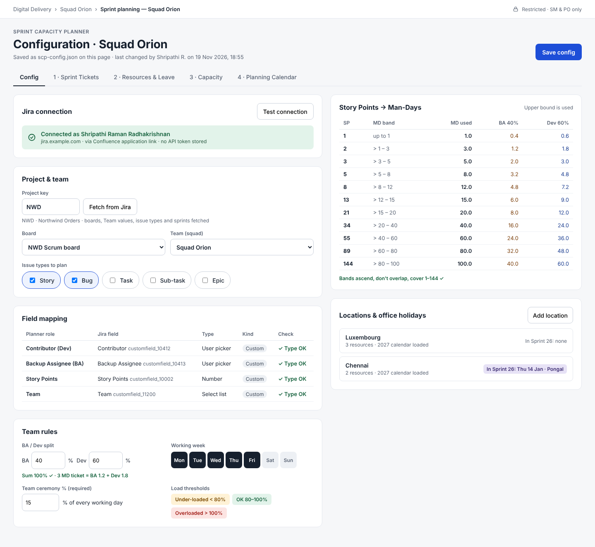
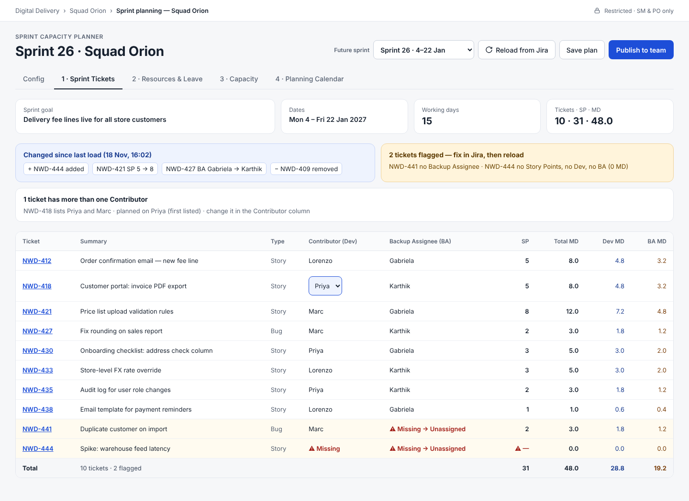
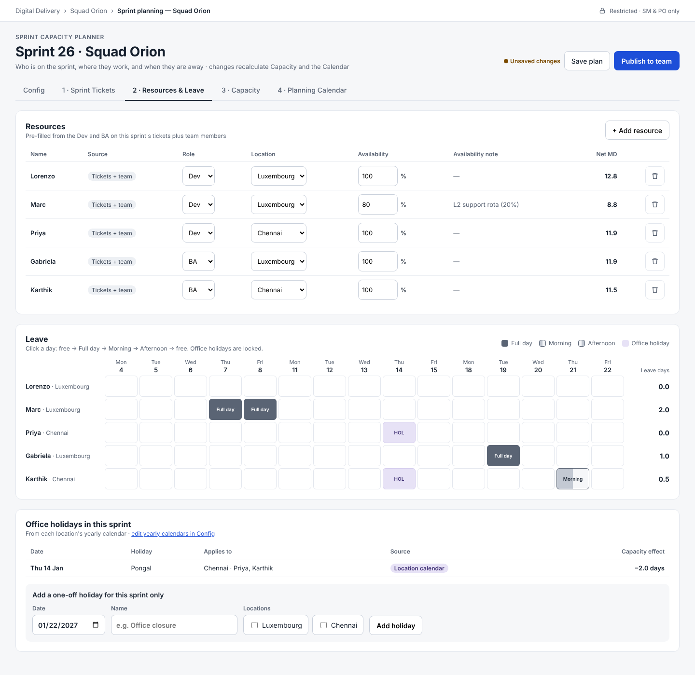
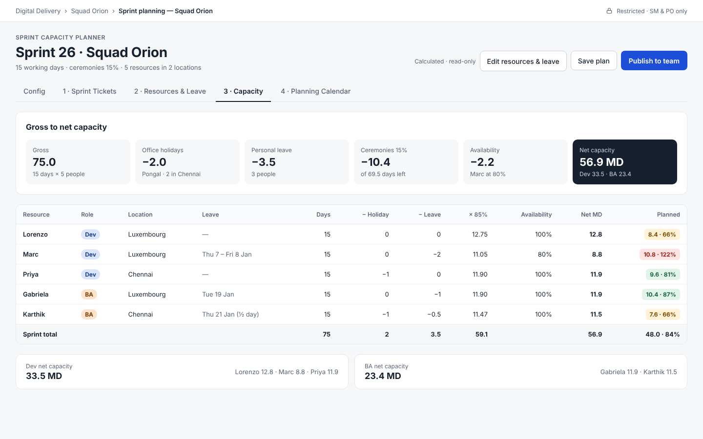
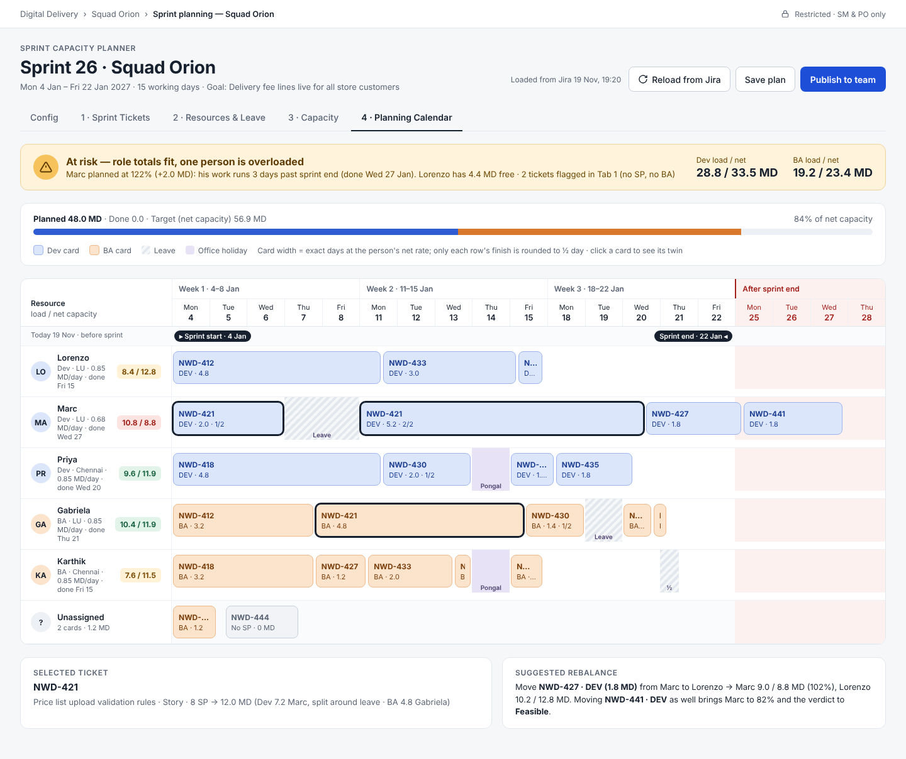
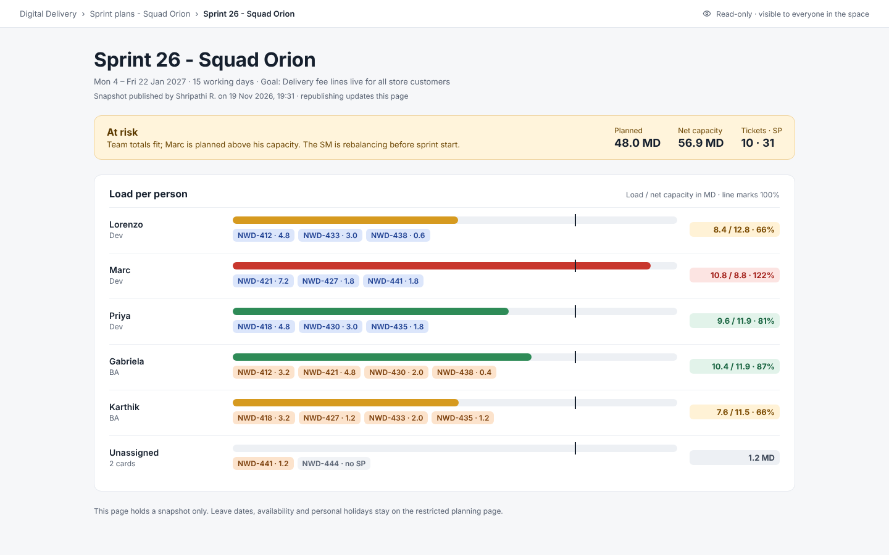

# User Stories & Prioritization — Sprint Capacity Planner

Nov 19, 2026 · @Shripathi Raman R

Version 0.2 (19 Nov 2026: US-01 and US-02 updated for PRD v0.6, typed project key with Fetch from Jira). Version 0.1 was reviewed by 3 Scrum Masters. 24 user stories cover every functional requirement in [PRD v0.6](https://claude.ai/artifact/Kg43FNpd8owHwh1pNzRmAb), grouped in six epics that follow the tabs. Each epic links to its screen on the design canvas (https://claude.ai/artifact/DMiZHX8VHaXQPBSEfd7bpY). Acceptance criteria are Given/When/Then; the scoring at the end is a first pass to be replaced by your team's and the vendor's numbers.

## Story index

17 stories are Must for the pilot, 4 Should, 3 Could (US-11 Reload moved to Must on 19 Nov 2026). Estimates are T-shirt sizes as a first guess, to be sized with the vendor at refinement.

| ID | Story | Persona | PRD requirement | PRD priority | MoSCoW | Size |
| --- | --- | --- | --- | --- | --- | --- |
| US-01 | Connect to Jira and test the link | SM | FR-1 | P0 | Must | S |
| US-02 | Type the project key and fetch boards, team, sprints and issue types | SM | FR-2, FR-3 | P0 | Must | M |
| US-03 | Map Jira fields | SM | FR-4 | P0 | Must | M |
| US-04 | Set SP-to-MD bands and BA/Dev split | SM | FR-5, FR-6 | P0 | Must | S |
| US-05 | Set working week, ceremony % and load thresholds | SM | FR-7, FR-8 | P0 | Must | S |
| US-06 | Maintain locations and yearly holiday calendars | SM | FR-27 | P0 | Must | M |
| US-07 | Open a plan for a future sprint | SM | FR-9, FR-10 | P0 | Must | S |
| US-08 | See tickets with MD per role | SM | FR-11 | P0 | Must | M |
| US-09 | See incomplete tickets flagged | SM | FR-13 | P0 | Must | S |
| US-10 | Pick the person on multi-person tickets | SM | FR-32 | P0 | Could | M |
| US-11 | Reload from Jira and see what changed | SM | FR-12 | P0 | Must | L |
| US-12 | Manage resources, role, location and availability | SM | FR-15, FR-18 | P0 | Must | M |
| US-13 | Enter leave on a day grid | SM | FR-18, FR-30 | P0 | Must | M |
| US-14 | See this sprint's holidays and add one-offs | SM | FR-17, FR-31 | P0 | Should | S |
| US-15 | See gross-to-net capacity | SM, PO | FR-14, FR-16, FR-19 | P0 | Must | S |
| US-16 | See auto-placed cards drawn in days | SM | FR-20, FR-21, FR-23 | P0 | Must | L |
| US-17 | Drag cards between people and days | SM | FR-22 | P0 | Should | L |
| US-18 | Get a sprint verdict | SM, PO | FR-24 | P0 | Must | M |
| US-19 | See which tickets cause an overload | PO | FR-24 (PRD US-11) | P1 | Could | S |
| US-20 | Save the whole plan once | SM | FR-25 | P0 | Must | M |
| US-21 | Lock the plan when the sprint starts | SM, Delivery Manager | FR-26 | P0 | Should | S |
| US-22 | Keep the planning page to SM and PO | SM, PO | FR-28 | P0 | Must | S |
| US-23 | Publish a team page per sprint | SM | FR-29 | P1 | Should | L |
| US-24 | See my own load on the team page | Team member | FR-29 (PRD US-12) | P2 | Could | S |

Personas follow the PRD: Scrum Master (SM, primary), Product Owner (PO), team members (Dev, BA), Delivery / Change Manager.

## Epic A — Config

Everything here is set once per team and saved with Save config (FR-8). Tabs 1-4 stay disabled until US-01 passes.

Screen design: [Config](https://claude.ai/artifact/DMiZHX8VHaXQPBSEfd7bpY#artboard-Config) — US-01 to US-06.

### US-01 · Connect to Jira and test the link

| ID | Persona | Priority | Epic | Size |
| --- | --- | --- | --- | --- |
| US-01 | Scrum Master | P0 · Must | Config | S |

**As a** Scrum Master, **I want** to test the page's connection to Jira, **so that** I know data will load before I start planning.

**Context.** FR-1 (PRD v0.6). The planner reads Jira through Confluence's own link to Jira, as the Release Impact admin tool does: Confluence lists its linked Jira servers and the link is taken from that list, so no API token and no link ID are stored or typed. Test connection checks the link and the user only and needs no project; the project is checked by Fetch from Jira (US-02).

**Acceptance criteria**

- **AC-1 Success** — **Given** Confluence is linked to Jira and I am authorised on the link, **when** I click Test connection, **then** I see "Connected as \<my name>" and Tabs 1-4 become available.
- **AC-2 Not authorised** — **Given** I have not yet authorised the link, **when** I test, **then** I see a message saying so with an Allow access link (or the step to authorise), and Tabs 1-4 stay disabled.
- **AC-3 Link missing** — **Given** Confluence is not linked to any Jira, **when** I test, **then** the message says the link is not configured and whom to contact, and Tabs 1-4 stay disabled.
- **AC-4 Proxy blocked** — **Given** Confluence refuses to pass calls to Jira, **when** I test, **then** the message says so and whom to contact, and Tabs 1-4 stay disabled.

**Design notes.** Green status box with the user's name; red box with the reason (see the Config screen on the design canvas).

**Technical notes.** `GET <ctx>/rest/jiraanywhere/1.0/servers` to find the linked Jira, then `GET /rest/api/2/myself` through the link proxy; code in `scp-jira.js`. Runs on its own when the page loads.

**Dependencies.** Confluence linked to jira.group.bank and the link authorised for planner users (Confluence admin, in place).

**Out of scope.** Any write to Jira. Checking the project (US-02).

### US-02 · Type the project key and fetch boards, team, sprints and issue types

| ID | Persona | Priority | Epic | Size |
| --- | --- | --- | --- | --- |
| US-02 | Scrum Master | P0 · Must | Config | M |

**As a** Scrum Master, **I want** to type our project key and fetch its boards, Team values, issue types and sprints with one click, **so that** I never scroll a long project list or type the rest by hand.

**Context.** FR-2 and FR-3 (PRD v0.6). The project key is a text field, upper-cased as typed, with a Fetch from Jira button beside it. Fetch also checks that I can read the project (moved here from US-01). Only the issue types I tick are planned, so sub-tasks and epics don't inflate the load.

**Acceptance criteria**

- **AC-1 Fetch** — **Given** I am connected and type PCAP, **when** I click Fetch from Jira, **then** its boards (a scrum board pre-selected), Team values, issue types and sprints load.
- **AC-2 Sprint details** — **Given** sprints have loaded, **when** I view them, **then** each shows name, state (active, future, closed), start and end date.
- **AC-3 Issue types** — **Given** I untick Bug, **when** Tab 1 loads, **then** no Bug tickets appear.
- **AC-4 Not found or no permission** — **Given** the key does not exist or I lack Browse Projects on it, **when** I click Fetch from Jira, **then** the message names the key and says it was not found or I lack Browse Projects on it, and nothing loads.
- **AC-5 Key edited** — **Given** I fetched PCAP, **when** I change the key without fetching again, **then** board, Team, issue types and sprints are marked stale and Save config is blocked until I fetch.
- **AC-6 Page load** — **Given** a key is saved in the config, **when** the page loads, **then** the connection test and the fetch run without a click.

**Design notes.** Project key field and Fetch from Jira button at the top of Project & team, then Board and Team (squad) dropdowns (Config screen on the design canvas).

**Technical notes.** `project/{key}` for the check and issue types, Agile board and sprint endpoints, JQL value suggestions for Team values (PRD Integration Points). Jira answers 404 both for a missing key and for one the user cannot browse, so AC-4 cannot say which.

**Dependencies.** US-01; Team field mapped (US-03) for Team values.

**Out of scope.** Picking the project from a list. Choosing several projects or teams on one page.

### US-03 · Map Jira fields

| ID | Persona | Priority | Epic | Size |
| --- | --- | --- | --- | --- |
| US-03 | Scrum Master | P0 · Must | Config | M |

**As a** Scrum Master, **I want** to map Contributor, Backup Assignee, Story Points and Team to my Jira fields, **so that** the planner reads the right data whatever IDs our instance uses.

**Context.** FR-4. All four are custom fields on Data Center; IDs are never hard-coded.

**Acceptance criteria**

- **AC-1 Field list** — **Given** I open a mapping picker, **when** it loads, **then** it lists the instance's fields with type and a Standard / Custom tag.
- **AC-2 Wrong type rejected** — **Given** I pick a text field for Contributor, **when** I confirm, **then** it is rejected with the expected type named.
- **AC-3 Single or multi-user** — **Given** Contributor is a multi-user picker, **when** I map it, **then** it is accepted.

**Dependencies.** US-02; Team field identified and filled on tickets (Jira admin, open).

**Out of scope.** Mapping roles other than Dev and BA.

### US-04 · Set SP-to-MD bands and BA/Dev split

| ID | Persona | Priority | Epic | Size |
| --- | --- | --- | --- | --- |
| US-04 | Scrum Master | P0 · Must | Config | S |

**As a** Scrum Master, **I want** to define the Story Point bands and the BA/Dev split once, **so that** every ticket converts to man-days the same way.

**Context.** FR-5 and FR-6. The band's upper bound is always used; default split 40 / 60.

**Acceptance criteria**

- **AC-1 Upper bound** — **Given** SP 2 has band above 1 up to 3, **when** a 2 SP ticket loads, **then** it counts 3 MD.
- **AC-2 Bad bands** — **Given** bands overlap or descend, **when** I save, **then** save is blocked with the faulty rows marked.
- **AC-3 Split sum** — **Given** BA 40 and Dev 50, **when** I save, **then** save is blocked showing "Sum 90%".
- **AC-4 Rounding** — **Given** 40 / 60 and a 3 MD ticket, **when** it is split, **then** BA is 1.2 and Dev 1.8.

**Technical notes.** Formulas in `scp-calc.js` only.

**Out of scope.** Per-ticket split override (v1.1 in the PRD risks).

### US-05 · Set working week, ceremony % and load thresholds

| ID | Persona | Priority | Epic | Size |
| --- | --- | --- | --- | --- |
| US-05 | Scrum Master | P0 · Must | Config | S |

**As a** Scrum Master, **I want** to set the working week, ceremony % and load thresholds, **so that** capacity and colours reflect how my team really works.

**Context.** FR-7 and FR-8. Ceremony % is required and has no default.

**Acceptance criteria**

- **AC-1 Ceremony required** — **Given** ceremony % is empty, **when** I open Tab 3 or 4, **then** they are blocked with a message pointing to Config.
- **AC-2 Thresholds recolour** — **Given** I change "overloaded" from 100% to 110%, **when** I return to Tab 4, **then** row badges recolour.
- **AC-3 Saved** — **Given** I click Save config, **when** I reload the page, **then** values persist and show last editor and date.

**Dependencies.** US-01.

### US-06 · Maintain locations and yearly holiday calendars

| ID | Persona | Priority | Epic | Size |
| --- | --- | --- | --- | --- |
| US-06 | Scrum Master | P0 · Must | Config | M |

**As a** Scrum Master, **I want** each location's yearly office holidays kept in one place, **so that** people in Luxembourg and Chennai lose only their own holidays.

**Context.** FR-27. Edited only in Config; Tab 2 shows the ones that fall in the sprint (US-14).

**Acceptance criteria**

- **AC-1 Per location** — **Given** Pongal is in the Chennai calendar only, **when** capacity is calculated, **then** only Chennai resources lose that day.
- **AC-2 Weekend rejected** — **Given** I enter a holiday on a Saturday, **when** I save, **then** it is rejected with a message.
- **AC-3 Shared** — **Given** a calendar is edited, **when** the next sprint is planned, **then** the change applies without re-entry.

**Dependencies.** Each member's location and each location's holiday list (pilot SM, open).

**Out of scope.** Importing holidays from HR or Outlook.

## Epic B — Tab 1 Sprint Tickets

Tab 1 turns the sprint's Jira tickets into man-days per role. Nothing here writes to Jira.

Screen design: [Tab 1 · Sprint Tickets](https://claude.ai/artifact/DMiZHX8VHaXQPBSEfd7bpY#artboard-Tickets) — sprint header (US-07), ticket table (US-08), flag panel (US-09), Contributor dropdown on PCAP-418 (US-10), change list and Reload (US-11).

### US-07 · Open a plan for a future sprint

| ID | Persona | Priority | Epic | Size |
| --- | --- | --- | --- | --- |
| US-07 | Scrum Master | P0 · Must | Sprint Tickets | S |

**As a** Scrum Master, **I want** to open a plan for the next future sprint and see its dates and goal, **so that** I plan against the right days.

**Context.** FR-9 and FR-10. One open plan per page, one page per team.

**Acceptance criteria**

- **AC-1 Future only** — **Given** the board has active, future and closed sprints, **when** I open the sprint selector, **then** only future sprints are listed.
- **AC-2 Header** — **Given** I open a plan for 3-21 Aug, **when** Tab 1 loads, **then** the header shows name, goal, dates and 15 working days.
- **AC-3 One open plan** — **Given** a plan is already open, **when** I start another, **then** I am asked to close the current plan first.

**Dependencies.** US-02, US-05.

**Out of scope.** Planning two future sprints at once.

### US-08 · See tickets with MD per role

| ID | Persona | Priority | Epic | Size |
| --- | --- | --- | --- | --- |
| US-08 | Scrum Master | P0 · Must | Sprint Tickets | M |

**As a** Scrum Master, **I want** each ticket's Dev, BA, Story Points and its Total, Dev and BA man-days, **so that** I know the workload per role before I commit.

**Context.** FR-11. Values rounded to 0.1 MD; Dev MD is the remainder so the two always add up.

**Acceptance criteria**

- **AC-1 Columns** — **Given** the sprint has tickets, **when** Tab 1 loads, **then** each row shows Ticket (link to Jira), Summary, Type, Contributor, Backup Assignee, SP, Total MD, Dev MD, BA MD.
- **AC-2 Totals** — **Given** a 10-ticket fixture, **when** it loads, **then** the totals row matches the hand-calculated values.
- **AC-3 Link** — **Given** I click a ticket key, **when** the link opens, **then** it goes to that ticket on jira.group.bank.

**Design notes.** Sprint Tickets screen on the design canvas; Dev values in blue, BA in orange.

**Dependencies.** US-03, US-04.

### US-09 · See incomplete tickets flagged

| ID | Persona | Priority | Epic | Size |
| --- | --- | --- | --- | --- |
| US-09 | Scrum Master | P0 · Must | Sprint Tickets | S |

**As a** Scrum Master, **I want** tickets with missing data flagged and counted, **so that** I fix them in Jira before planning on wrong numbers.

**Context.** FR-13 as aligned with Edge Cases in v0.4: only a ticket with no SP (or SP outside the bands) is 0 MD; a missing Dev or BA keeps the other half.

**Acceptance criteria**

- **AC-1 No SP** — **Given** a ticket has no Story Points, **when** Tab 1 loads, **then** it is flagged, counts 0 MD and its card sits greyed in Unassigned.
- **AC-2 No BA** — **Given** a 2 SP ticket has a Dev but no BA, **when** it loads, **then** Dev 1.8 MD stays on the Dev and BA 1.2 MD goes to Unassigned.
- **AC-3 Outside bands** — **Given** SP 13 with bands only up to 8, **when** it loads, **then** it is flagged "SP outside bands" and counts 0 MD.
- **AC-4 Count** — **Given** flags exist, **when** I view the tab, **then** a summary states how many tickets are flagged and why.

**Dependencies.** US-08.

### US-10 · Pick the person on multi-person tickets

| ID | Persona | Priority | Epic | Size |
| --- | --- | --- | --- | --- |
| US-10 | Scrum Master | P0 · Could | Sprint Tickets | M |

**As a** Scrum Master, **I want** to choose which listed person a multi-person ticket is planned on, **so that** the load lands on whoever actually does the work.

**Context.** FR-32. Default is the first name listed; a drag in Tab 4 always wins over the dropdown.

**Acceptance criteria**

- **AC-1 Default** — **Given** Contributor holds A and B, **when** Tab 1 loads, **then** a dropdown shows A selected and the ticket is planned on A.
- **AC-2 Pick** — **Given** I pick B and save the plan, **when** I reload, **then** the ticket is still planned on B.
- **AC-3 Removed in Jira** — **Given** B is removed from the field in Jira, **when** I reload, **then** the ticket returns to A and Reload lists the change.
- **AC-4 Calendar wins** — **Given** I drag the Dev card to C in Tab 4, **when** I return to Tab 1, **then** the cell shows C, marked "moved in calendar".

**Dependencies.** US-03, US-17 for AC-4.

**Open questions.**

- [ ] Are Contributor and Backup Assignee multi-user pickers today? If not, this story can be dropped.

### US-11 · Reload from Jira and see what changed

| ID | Persona | Priority | Epic | Size |
| --- | --- | --- | --- | --- |
| US-11 | Scrum Master | P0 · Must | Sprint Tickets | L |

**As a** Scrum Master, **I want** to reload the sprint and see what changed since the last load, **so that** late grooming changes don't slip past me.

**Context.** FR-12, plus the edge cases for changed sprint dates and removed tickets.

**Acceptance criteria**

- **AC-1 Change list** — **Given** SP changed on one ticket and another was removed, **when** I click Reload, **then** both changes are listed with the last-loaded time.
- **AC-2 Removed ticket** — **Given** a ticket left the sprint, **when** I reload, **then** its cards are deleted from the plan.
- **AC-3 New dates** — **Given** the sprint end moved earlier, **when** I reload, **then** capacity recalculates and cards beyond the new end move to Unassigned.
- **AC-4 Jira down** — **Given** Jira is unreachable, **when** the page loads, **then** the last data stays visible with a banner and Reload is disabled.

**Technical notes.** Diff computed against the ticket fields stored in `scp-plan.json`.

**Dependencies.** US-08, US-20.

## Epic C — Tab 2 Resources & Leave

Tab 2 holds every per-sprint input about people. Leave is personal data and stays on the restricted planning page (US-22).

Screen design: [Tab 2 · Resources & Leave](https://claude.ai/artifact/DMiZHX8VHaXQPBSEfd7bpY#artboard-Resources) — resource table (US-12), clickable leave grid (US-13), holidays in this sprint and one-off form (US-14).

### US-12 · Manage resources, role, location and availability

| ID | Persona | Priority | Epic | Size |
| --- | --- | --- | --- | --- |
| US-12 | Scrum Master | P0 · Must | Resources & Leave | M |

**As a** Scrum Master, **I want** a resource list pre-filled from the tickets and team, where I set role, location and availability, **so that** capacity is based on the people who really work this sprint.

**Context.** FR-15 and the availability part of FR-18. Availability covers support duty, part-time and other projects; ceremonies are deducted separately.

**Acceptance criteria**

- **AC-1 Pre-filled** — **Given** the sprint's tickets name five people, **when** Tab 2 opens, **then** each appears once with role and location from the last plan.
- **AC-2 Not in team** — **Given** a ticket names someone outside the team, **when** Tab 2 opens, **then** that person shows a "not in team" tag to confirm or remove.
- **AC-3 Location required** — **Given** a resource has no location, **when** I open Tab 3, **then** capacity is blocked until one is set.
- **AC-4 Live net** — **Given** I set Marc to 80%, **when** the value changes, **then** his net MD updates on the row.

**Design notes.** Resources & Leave screen on the design canvas.

**Dependencies.** US-06, US-07.

**Out of scope.** Roles other than Dev, BA or Both.

### US-13 · Enter leave on a day grid

| ID | Persona | Priority | Epic | Size |
| --- | --- | --- | --- | --- |
| US-13 | Scrum Master | P0 · Must | Resources & Leave | M |

**As a** Scrum Master, **I want** to click days on a person-by-day grid to mark leave, **so that** I record absences in seconds instead of typing dates.

**Context.** FR-18 and FR-30.

**Acceptance criteria**

- **AC-1 Cycle** — **Given** a working day, **when** I click it repeatedly, **then** it cycles free, full day, half day, free.
- **AC-2 Holiday locked** — **Given** a day is an office holiday for that person's location, **when** I click it, **then** nothing changes.
- **AC-3 Totals** — **Given** Marc has two full days of leave, **when** I look at his row, **then** his leave total reads 2.0 and his net reads 8.8 MD (80%, 15% ceremonies).
- **AC-4 Keyboard** — **Given** I use the keyboard, **when** I tab to a day and press Enter, **then** it cycles as with a click.

**Technical notes.** Leave stored per person per day in `scp-plan.json`; never copied to the snapshot.

**Dependencies.** US-12.

**Out of scope.** Importing leave from HR or Outlook.

### US-14 · See this sprint's holidays and add one-offs

| ID | Persona | Priority | Epic | Size |
| --- | --- | --- | --- | --- |
| US-14 | Scrum Master | P0 · Should | Resources & Leave | S |

**As a** Scrum Master, **I want** to see which office holidays fall in this sprint and add a one-off closure, **so that** I spot capacity loss without opening Config.

**Context.** FR-17 and FR-31. Yearly calendars stay in Config (US-06).

**Acceptance criteria**

- **AC-1 List** — **Given** Pongal falls on 14 Jan, **when** Tab 2 opens, **then** it shows date, name, Chennai, source "Location calendar" and -2.0 days.
- **AC-2 One-off** — **Given** I add an office closure for Luxembourg only, **when** I add it, **then** only Luxembourg resources lose the day and the source reads "One-off".
- **AC-3 Link** — **Given** I want to change a yearly holiday, **when** I click the link, **then** Config opens at the locations section.

**Dependencies.** US-06, US-12.

## Epic D — Tab 3 Capacity

Tab 3 is read-only: it calculates and shows, and every input is edited in Config or Tab 2.

Screen design: [Tab 3 · Capacity](https://claude.ai/artifact/DMiZHX8VHaXQPBSEfd7bpY#artboard-Capacity) — gross-to-net strip and per-resource table (US-15).

### US-15 · See gross-to-net capacity

| ID | Persona | Priority | Epic | Size |
| --- | --- | --- | --- | --- |
| US-15 | Scrum Master, Product Owner | P0 · Must | Capacity | S |

**As a** Scrum Master, **I want** to see how gross capacity becomes net capacity per person, per role and for the sprint, **so that** I can explain every man-day the team commits to.

**Context.** FR-14, FR-16 and FR-19. Formula: (working days - office holidays - leave) x (1 - ceremony %) x availability %.

**Acceptance criteria**

- **AC-1 Gross** — **Given** 15 working days and 5 resources, **when** Tab 3 opens, **then** gross reads 75.0 MD.
- **AC-2 Worked example** — **Given** a Luxembourg Dev at 80% with 2 days' leave, 1 Luxembourg holiday and 15% ceremonies, **when** Tab 3 opens, **then** that person's net reads 8.2 MD (8.16).
- **AC-3 Steps add up** — **Given** any resource, **when** I read the row, **then** gross minus holidays minus leave, times ceremonies and availability, equals the net shown, per person and per role.
- **AC-4 Read-only** — **Given** I am on Tab 3, **when** I look for inputs, **then** there are none, and "Edit resources & leave" opens Tab 2.

**Design notes.** Gross-to-net strip of six figures, then a per-resource table (Capacity screen on the design canvas).

**Technical notes.** All values come from `scp-calc.js`; one decimal everywhere.

**Dependencies.** US-05, US-06, US-12, US-13.

## Epic E — Tab 4 Planning Calendar

Tab 4 answers the planning question: can this team finish this sprint? Cards are drawn in days at each person's net rate, so overload shows as work running past the sprint end.

Screen design: [Tab 4 · Planning Calendar](https://claude.ai/artifact/DMiZHX8VHaXQPBSEfd7bpY#artboard-Main) — cards in days with the After sprint end zone (US-16), verdict banner (US-18), suggested rebalance panel (US-19). Drag and drop (US-17) is described in its acceptance criteria; the static screen shows the result, not the gesture.

### US-16 · See auto-placed cards drawn in days

| ID | Persona | Priority | Epic | Size |
| --- | --- | --- | --- | --- |
| US-16 | Scrum Master | P0 · Must | Planning Calendar | L |

**As a** Scrum Master, **I want** every ticket placed automatically on a person-by-day calendar with cards as long as the work really takes, **so that** I see at a glance who finishes in time and who doesn't.

**Context.** FR-20, FR-21 and FR-23 (v0.4: exact card length, rounding only at each row's finish).

**Acceptance criteria**

- **AC-1 Two cards per ticket** — **Given** a ticket with a Dev and a BA, **when** Tab 4 opens, **then** a Dev card sits on the Dev's row and a BA card on the BA's row, same key, different colour and tag.
- **AC-2 Length in days** — **Given** Marc does 0.68 MD a day, **when** his 7.2 MD card is placed, **then** it spans 10.6 days and his load still counts 7.2 MD.
- **AC-3 Around absences** — **Given** a card reaches a leave or holiday day, **when** it is placed, **then** it splits around the shaded day and keeps its total MD.
- **AC-4 Past sprint end** — **Given** a row's work runs beyond the last sprint day, **when** Tab 4 opens, **then** the overflow shows in the red "After sprint end" zone and the row header shows its Done date.
- **AC-5 Unassigned** — **Given** a card has no person, **when** placed, **then** it goes to the Unassigned lane.

**Design notes.** Planning Calendar screen on the design canvas; header badge "load / net" coloured by the FR-7 thresholds; hover shows the breakdown.

**Technical notes.** Card geometry from `scp-calc.js`; one grid unit = 0.1 day.

**Dependencies.** US-08, US-15.

### US-17 · Drag cards between people and days

| ID | Persona | Priority | Epic | Size |
| --- | --- | --- | --- | --- |
| US-17 | Scrum Master | P0 · Should | Planning Calendar | L |

**As a** Scrum Master, **I want** to drag a card to another person or day, **so that** I can rebalance load before committing.

**Context.** FR-22. Dropped cards snap their start to the nearest half day; overlapped cards move right. Moves live only in the plan, never in Jira.

**Acceptance criteria**

- **AC-1 Live update** — **Given** I drag Marc's PCAP-427 Dev card to Lorenzo, **when** I drop it, **then** both loads and the verdict update within 1 second.
- **AC-2 Snap** — **Given** I drop a card at day 3.3, **when** it lands, **then** it starts at day 3.5.
- **AC-3 No overlap** — **Given** I drop onto another card, **when** it lands, **then** later cards on that row move right and none overlap.
- **AC-4 Wrong role** — **Given** I drop a Dev card on a BA-only resource, **when** I release, **then** I am asked to confirm.
- **AC-5 Keyboard** — **Given** a card has focus, **when** I use the move keys, **then** I can change its person and day without a mouse.

**Dependencies.** US-16.

**Out of scope.** Writing reassignments back to Jira.

### US-18 · Get a sprint verdict

| ID | Persona | Priority | Epic | Size |
| --- | --- | --- | --- | --- |
| US-18 | Scrum Master, Product Owner | P0 · Must | Planning Calendar | M |

**As a** Scrum Master, **I want** a clear Feasible, At risk or Not feasible verdict, **so that** I decide to commit or trim scope with evidence.

**Context.** FR-24 and the verdict table in Calculation Rules.

**Acceptance criteria**

- **AC-1 Feasible** — **Given** both roles fit and nobody is above 100%, **when** Tab 4 opens, **then** the banner reads Feasible.
- **AC-2 At risk** — **Given** role totals fit but Marc is at 122%, **when** Tab 4 opens, **then** the banner reads At risk and names Marc, his overrun and his finish date.
- **AC-3 Not feasible** — **Given** BA load exceeds BA net, **when** Tab 4 opens, **then** the banner reads Not feasible and names the biggest gap.
- **AC-4 Card on absence** — **Given** a card sits on a leave day, **when** the verdict is computed, **then** it is at least At risk.

**Dependencies.** US-15, US-16.

### US-19 · See which tickets cause an overload

| ID | Persona | Priority | Epic | Size |
| --- | --- | --- | --- | --- |
| US-19 | Product Owner | P1 · Could | Planning Calendar | S |

**As a** Product Owner, **I want** to see which tickets push a person or role over capacity, **so that** I know what to drop or defer.

**Context.** PRD US-11. The calendar mock-up shows a "Suggested rebalance" panel; this story is the minimum: list the tickets behind each overload.

**Acceptance criteria**

- **AC-1 Overload list** — **Given** the verdict is At risk or Not feasible, **when** I open the overload detail, **then** I see each overloaded person or role with the tickets that run past capacity, largest first.
- **AC-2 Removal effect** — **Given** I select a ticket in that list, **when** I view it, **then** I see what the verdict would become without it.

**Dependencies.** US-18.

**Out of scope.** Removing the ticket from the sprint in Jira.

## Epic F — Save, access and publish

These stories keep the plan safe, keep leave private and let the whole team see the commitment.

Screen design: Save plan and Publish to team in the header of [every tab](https://claude.ai/artifact/DMiZHX8VHaXQPBSEfd7bpY#artboard-Tickets) (US-20), the "Restricted · SM & PO only" marker (US-22), and the [Published sprint page](https://claude.ai/artifact/DMiZHX8VHaXQPBSEfd7bpY#artboard-Published) (US-23, US-24). The read-only state (US-21) has no screen yet.

### US-20 · Save the whole plan once

| ID | Persona | Priority | Epic | Size |
| --- | --- | --- | --- | --- |
| US-20 | Scrum Master | P0 · Must | Save, access, publish | M |

**As a** Scrum Master, **I want** one Save plan button that saves every tab, **so that** I never lose changes made in another tab.

**Context.** FR-25 (v0.4: single save for Tabs 1-4) and the concurrent-edit edge case.

**Acceptance criteria**

- **AC-1 One save** — **Given** I changed a dropdown in Tab 1, leave in Tab 2 and a card in Tab 4, **when** I click Save plan once and reload, **then** all three changes are kept.
- **AC-2 Same place** — **Given** I am on any of Tabs 1-4, **when** I look at the header, **then** Save plan is in the same position.
- **AC-3 Unsaved warning** — **Given** I have unsaved changes, **when** I leave the page, **then** I am asked to confirm.
- **AC-4 Concurrent edit** — **Given** the PO saved after I opened the plan, **when** I save, **then** I am warned the plan changed since I opened it before anything is overwritten.
- **AC-5 Jira untouched** — **Given** I save, **when** I check Jira history, **then** no change was made by the tool.

**Technical notes.** `scp-store.js` checks the attachment version before writing `scp-plan.json`.

**Dependencies.** US-07.

### US-21 · Lock the plan when the sprint starts

| ID | Persona | Priority | Epic | Size |
| --- | --- | --- | --- | --- |
| US-21 | Scrum Master, Delivery Manager | P0 · Should | Save, access, publish | S |

**As a** Delivery Manager, **I want** a plan to freeze when its sprint starts, **so that** it stays as the record of what the team committed to.

**Context.** FR-26.

**Acceptance criteria**

- **AC-1 Read-only** — **Given** the sprint became active in Jira, **when** the planning page loads, **then** every input and drag is disabled with a banner saying why.
- **AC-2 Kept** — **Given** the plan is frozen, **when** I open it, **then** cards, loads and verdict show as at sprint start.

**Dependencies.** US-20.

### US-22 · Keep the planning page to SM and PO

| ID | Persona | Priority | Epic | Size |
| --- | --- | --- | --- | --- |
| US-22 | Scrum Master, Product Owner | P0 · Must | Save, access, publish | S |

**As a** Scrum Master, **I want** only the SM and PO to open the planning page, **so that** colleagues' leave and availability stay private (GDPR, Luxembourg).

**Context.** FR-28. Done with Confluence page restrictions, not code.

**Acceptance criteria**

- **AC-1 Blocked** — **Given** I am a team member who is not SM or PO, **when** I open the planning page or one of its attachments, **then** access is refused.
- **AC-2 Allowed** — **Given** I am the SM or PO, **when** I open the page, **then** I can edit the plan and see leave.

**Dependencies.** Confluence space admin.

### US-23 · Publish a team page per sprint

| ID | Persona | Priority | Epic | Size |
| --- | --- | --- | --- | --- |
| US-23 | Scrum Master | P1 · Should | Save, access, publish | L |

**As a** Scrum Master, **I want** to publish a read-only page for the sprint, **so that** the whole team sees the commitment without seeing anyone's leave.

**Context.** FR-29 and File Structure: the sprint page holds its snapshot; the viewer files sit on the parent page "Sprint plans - \<Squad>". Cross-page loading tested on 19 Nov 2026.

**Acceptance criteria**

- **AC-1 First publish** — **Given** no page exists, **when** I click Publish, **then** "Sprint 26 - Squad Orion" is created under the parent page, creating the parent if needed.
- **AC-2 Republish** — **Given** the page exists, **when** I publish again, **then** the same page is updated and no duplicate appears.
- **AC-3 No leave** — **Given** the page is published, **when** I open `scp-snapshot.json`, **then** it holds no leave dates, availability % or per-person holidays.
- **AC-4 Name clash** — **Given** a page with that title exists but was not created by this plan, **when** I publish, **then** Publish stops and names the page; nothing is overwritten.

**Technical notes.** `POST /rest/api/content` as the publishing user; parent found by stored page ID.

**Dependencies.** US-20, US-22.

### US-24 · See my own load on the team page

| ID | Persona | Priority | Epic | Size |
| --- | --- | --- | --- | --- |
| US-24 | Team member (Dev or BA) | P2 · Could | Save, access, publish | S |

**As a** developer or BA, **I want** to see my planned tickets and load on the published page, **so that** I can flag a mistake before the sprint starts.

**Context.** PRD US-12. Uses the published page only; team members have no access to the planning page.

**Acceptance criteria**

- **AC-1 My row** — **Given** the plan is published, **when** I open the sprint page, **then** I see my tickets, load and net capacity.
- **AC-2 Others' privacy** — **Given** I view the page, **when** I look at any row, **then** no leave dates or availability % appear.

**Dependencies.** US-23.

**Out of scope.** Team members editing their own leave in the tool.

## Prioritization

**Decision:** which stories go into the pilot release for one team, and which follow. **Recommendation:** build the 17 Must stories, including US-11 Reload, as Release 1; drag and drop (US-17) and Publish (US-23) follow in Release 2. Every score below is Claude's judgment from the PRD, not team or vendor data; replace it at refinement.

### Which frameworks ran

ICE, MoSCoW and Weighted Scoring ran. **RICE was excluded:** reach is the same for every story (one pilot team, one SM and one PO), so it cannot separate items, and there are no effort estimates yet. It becomes useful once the vendor sizes the stories and more teams join. **Kano was excluded:** three SMs have reviewed and agreed the stories, but their feedback was not collected per feature in Kano form (how they'd feel with and without each feature), so Kano stays out. Agreed on 19 Nov 2026.

### ICE (Impact x Confidence x Ease, each 1-10)

| Rank | Story | Impact | Confidence | Ease | ICE |
| --- | --- | --- | --- | --- | --- |
| 1 | US-04 Bands and split | 9 | 9 | 8 | 648 |
| 1 | US-15 Gross-to-net capacity | 9 | 9 | 8 | 648 |
| 1 | US-22 SM/PO restriction | 8 | 9 | 9 | 648 |
| 4 | US-18 Sprint verdict | 10 | 9 | 7 | 630 |
| 5 | US-07 Open plan | 8 | 9 | 8 | 576 |
| 6 | US-01 Jira connection | 9 | 9 | 7 | 567 |
| 6 | US-08 Ticket table | 9 | 9 | 7 | 567 |
| 6 | US-12 Resources | 9 | 9 | 7 | 567 |
| 9 | US-05 Week, ceremony, thresholds | 7 | 8 | 9 | 504 |
| 10 | US-02 Project key and fetch | 8 | 8 | 7 | 448 |
| 10 | US-09 Flags | 7 | 8 | 8 | 448 |
| 12 | US-20 Save plan | 9 | 8 | 6 | 432 |
| 13 | US-13 Leave grid | 8 | 8 | 6 | 384 |
| 14 | US-03 Field mapping | 9 | 7 | 6 | 378 |
| 15 | US-06 Locations and calendars | 7 | 7 | 7 | 343 |
| 16 | US-21 Read-only at start | 5 | 8 | 8 | 320 |
| 17 | US-14 Sprint holidays, one-offs | 6 | 7 | 7 | 294 |
| 18 | US-16 Cards in days | 9 | 7 | 4 | 252 |
| 18 | US-19 PO overload view | 6 | 6 | 7 | 252 |
| 20 | US-11 Reload and diff | 6 | 7 | 5 | 210 |
| 20 | US-23 Publish | 7 | 6 | 5 | 210 |
| 20 | US-24 Own load on team page | 5 | 6 | 7 | 210 |
| 23 | US-17 Drag and drop | 7 | 7 | 3 | 147 |
| 24 | US-10 Multi-person pick | 4 | 4 | 6 | 96 |

The top tier (ICE 504-648) is the configuration and calculation core; the bottom tier (96-252) is interaction and sharing, held down by low Ease.

### MoSCoW (pilot release)

| Bucket | Stories | Why |
| --- | --- | --- |
| Must | US-01-09, US-11, US-12, US-13, US-15, US-16, US-18, US-20, US-22 | Without any of these the verdict is wrong, can't be produced, or leave data is exposed |
| Should | US-14, US-17, US-21, US-23 | Make the pilot usable week to week; workarounds exist for a short time |
| Could | US-10, US-19, US-24 | Useful, but no pilot goal depends on them |
| Won't (v1) | Jira write-back, multi-sprint plans, HR leave import, roles beyond Dev/BA | PRD Out of Scope |

### Weighted Scoring (1-5 per criterion)

**These weights are equal (20% each) by default, which is itself a choice.** Change them to reflect what your organisation values; a data protection view would weight Privacy higher. Ease and Low risk score higher when a story is easier or safer.

| Story | Plan accuracy | SM time saved | Privacy | Ease | Low risk | Score |
| --- | --- | --- | --- | --- | --- | --- |
| US-04 | 5 | 4 | 3 | 5 | 5 | 4.4 |
| US-08 | 5 | 5 | 3 | 4 | 5 | 4.4 |
| US-15 | 5 | 4 | 3 | 5 | 5 | 4.4 |
| US-05 | 5 | 3 | 3 | 5 | 5 | 4.2 |
| US-09 | 5 | 4 | 3 | 4 | 5 | 4.2 |
| US-18 | 5 | 5 | 3 | 4 | 4 | 4.2 |
| US-22 | 3 | 3 | 5 | 5 | 5 | 4.2 |
| US-12 | 5 | 4 | 3 | 4 | 4 | 4.0 |
| US-01 | 4 | 4 | 3 | 4 | 4 | 3.8 |
| US-02 | 3 | 5 | 3 | 4 | 4 | 3.8 |
| US-06 | 5 | 3 | 3 | 4 | 4 | 3.8 |
| US-07 | 3 | 4 | 3 | 4 | 5 | 3.8 |
| US-14 | 4 | 3 | 3 | 4 | 4 | 3.6 |
| US-03 | 5 | 3 | 3 | 3 | 3 | 3.4 |
| US-11 | 4 | 4 | 3 | 3 | 3 | 3.4 |
| US-13 | 5 | 4 | 2 | 3 | 3 | 3.4 |
| US-19 | 3 | 3 | 3 | 4 | 4 | 3.4 |
| US-20 | 4 | 4 | 3 | 3 | 3 | 3.4 |
| US-16 | 5 | 4 | 3 | 2 | 2 | 3.2 |
| US-21 | 3 | 2 | 3 | 4 | 4 | 3.2 |
| US-24 | 2 | 3 | 3 | 4 | 4 | 3.2 |
| US-23 | 3 | 4 | 3 | 3 | 2 | 3.0 |
| US-10 | 3 | 2 | 3 | 3 | 3 | 2.8 |
| US-17 | 3 | 4 | 3 | 1 | 2 | 2.6 |

US-13 scores Privacy 2 because it is the story that handles personal leave data.

### Where the frameworks agree and diverge

| Story | ICE rank | Weighted rank | MoSCoW | PRD | Agreement |
| --- | --- | --- | --- | --- | --- |
| US-04, US-15, US-18 | 1-4 | 1-4 | Must | P0 | Strong |
| US-22 | 1 | 4 | Must | P0 | Strong |
| US-01, US-07, US-08, US-12 | 5-6 | 1-9 | Must | P0 | Strong |
| US-02, US-05, US-09 | 9-10 | 4-9 | Must | P0 | Strong |
| US-03 Field mapping | 14 | 14 | Must | P0 | Divergent |
| US-16 Cards in days | 18 | 19 | Must | P0 | Divergent |
| US-17 Drag and drop | 23 | 24 | Should | P0 | Divergent |
| US-11 Reload | 20 | 14 | Must (promoted) | P0 | Divergent |
| US-23 Publish | 20 | 22 | Should | P1 | Partial |
| US-06, US-13, US-20 | 12-15 | 9-14 | Must | P0 | Partial |
| US-14, US-21 | 16-17 | 13-19 | Should | P0 | Strong |
| US-10, US-19, US-24 | 18-24 | 14-23 | Could | P0-P2 | Strong |

- **US-03 and US-16 rank low only because of Ease.** Both are enablers: nothing loads without field mapping, and the calendar is what makes overload visible. Scoring frameworks under-value enablers; they stay Must.
- **US-17 is the real disagreement.** The PRD calls drag and drop P0; both frameworks put it last, because it is the hardest story (exact-length cards, snapping, pushing, keyboard access). The pilot can run without it if the SM fixes assignments in Jira and reloads.
- **That makes US-11 Reload more important than its scores say.** Without drag and drop, Reload is the SM's only way to act on the verdict, so it moved from Should to Must (agreed 19 Nov 2026).

### Sensitivity

- **If the vendor sizes drag and drop as moderate** (Ease 3 to 7), US-17 scores 343, around rank 15: still below the Musts, but cheap enough to pull into Release 1.
- **If Privacy is weighted 40%**, US-22 becomes the clear first item and US-13 falls to the bottom third. The cut line doesn't move, because both stay Must.
- **If Jira confirms multi-user fields are common** (US-10 Impact 7, Confidence 8), US-10 scores 336 and becomes a Should. If they are single-user pickers, it becomes Won't.

### Recommended release cut

| Release | Stories | Goal |
| --- | --- | --- |
| Release 1, pilot sprint 1 | US-01-09, US-11, US-12, US-13, US-15, US-16, US-18, US-20, US-22 | A correct verdict the SM can act on through Jira and Reload |
| Release 2, pilot sprint 2-3 | US-14, US-17, US-21, US-23 | Rebalance in the tool, share with the team, keep the record |
| Later | US-19, US-24, US-10 (only if multi-user fields are used) | PO and team convenience |

**Next step:** at the next vendor refinement, size all 24 stories in story points, replace the Ease scores with those sizes and rerun ICE. Confirm with the Jira admin whether Contributor and Backup Assignee are multi-user pickers.

### Limitations

- **The scores are one person's judgment.** Impact and Confidence come from reading the PRD, not from SMs; Ease is a guess until the vendor sizes the stories.
- **ICE and Weighted Scoring favour small, self-contained stories** and under-rate enablers whose value appears only through other stories (US-03, US-16).
- **Privacy is scored per story,** but the real exposure comes from how stories combine (leave in Tab 2, the snapshot in US-23). Review it across stories, not one at a time.
- **No framework here measures adoption,** the PRD goal "SMs stop using their spreadsheet". A Kano run with pilot SMs would show which stories they treat as must-haves.
